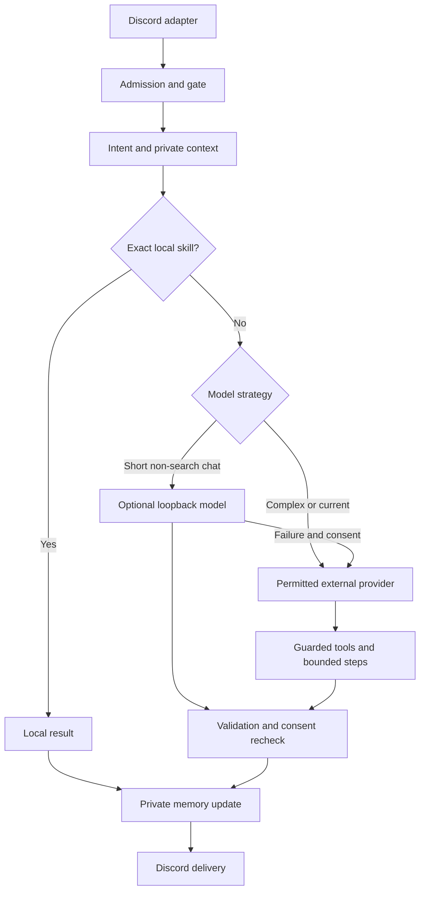

# Miko Brain v2

## Audit and architectural decision

Inspected baseline `414942b1280501415325efdb6ba464876be50e1e` before implementation. The baseline passed **60 tests**. This is the `krishna3251/rule-34` application; no code or state was imported from Lxeus or Rukiya.

The repository already had a modular chat engine, rich character voice, scoped verification, a bounded agent loop and permission-aware tools. Replacing the entire application would needlessly risk those features. This change substantially rebuilds the **conversation core** and its storage/model boundaries within the existing modular monolith. Prefix/slash names, discovery adapters, verification records, game catalogs and community controls remain.

| Area | Baseline / finding | Change |
| --- | --- | --- |
| Runtime | Python, discord.py, aiohttp, SQLite, optional Groq/OpenRouter/Gemini; Python 3.12 CI | Same framework and requirements; no new package dependency |
| Entry point | `main.py` creates MikoBot, discovers cogs, runs health/backup tasks | Chat shutdown explicitly closes inference clients and active tasks |
| Discord surface | Verification, discovery, catalogs/ratings, reverse-image search, roleplay, diagnostics and Miko chat | Existing commands preserved; one private `/mikobrain` group added |
| Conversation | `handle` and `ask_direct` duplicated orchestration | Both use one admission boundary and one gate-to-response path |
| Routing | Every conversational request needed a provider; substring matches misclassified words such as “signal” and “costume” | Exact local skills, retrieval, word-boundary routing, optional local model, external fallback |
| Persistence | Full JSON history rewritten and fsynced twice per turn; channel history shared among users | Bounded ephemeral private history by default; optional SQLite history; explicit approved facts |
| External requests | New aiohttp session per OpenRouter call; synchronous Groq SDK in worker | Pooled HTTP, native AsyncGroq, bounded retries, timeouts, operation cap and closure |
| Resource limits | AI semaphore protected only generation; waiting tasks/state could accumulate | Admission covers the complete pipeline, no unbounded wait queue; bounded state and deduplication |
| Tools | Model could select arbitrary user-facing commands after a coarse action classification | Metadata tools remain; automatic command invocation restricted to a small read-only list; normal commands remain available |
| Safety | Existing consent and verification, output validator and clean retries | Preserved, with private memory scopes, egress opt-out and cancellation before privacy changes |
| Assets | First-use emotion conversion/catalog parsing could block message delivery | Catalog/context assembly and emotion conversion run in workers |
| Deployment | No Render blueprint/Dockerfile in this repository; Flask health server; vendored packages inactive | No deployment service or runtime database altered |

The complete source import inventory is [docs/module_dependencies.json](docs/module_dependencies.json), generated with `python scripts/audit_modules.py`. It lists all 65 application modules, import edges, dynamic cog loading and test files. It intentionally excludes vendored dependencies and runtime data.

## How a request works



1. Admission caps total, guild, user and same-conversation work. Stable Discord event/interaction IDs are deduplicated for 120 seconds (2,048 entries). Normal commands are still handled by Discord's existing dispatcher.
2. Existing summon, reply, auto-chat sampling, cooldown, daily request quota, tone and safety checks run. Auto-chat remains administrator configured; it does not collect every server message.
3. Exact requests run locally: `calculate (8+3)*7`, `my id`, `server info`, `channel info`, `list commands`, `memory: favorite_game`, `knowledge: rules`. These are functional operations, not a scripted conversational persona. The arithmetic parser never uses eval; operands, exponent, AST size and cache size are capped.
4. Otherwise compile personality, style, relevant approved facts, recent private turns and allowed catalog/knowledge data. Retain the core character instructions and current request; drop optional blocks/old turns to fit the character budget. Data is labeled untrusted; application permissions remain authoritative.
5. Short non-search chat prefers optional local inference. Coding, action and long requests prefer stronger remote inference when allowed. Disabling external AI lets the local model attempt complex offline requests too. Fresh-information requests never route to local inference. Routing is a lightweight heuristic, not an extra LLM call or a guarantee of semantic understanding.
6. OpenRouter remains the remote primary, Groq the fallback. Per-request external consent applies through all tool turns and validation repairs. With neither model available, Miko gives a truthful availability message; ordinary commands and deterministic skills remain usable.
7. Existing agent iteration/call limits, response validation, clean retry and last-moment flirting/access recheck still apply. Completed turns update private context. No user-only partial turn is stored before inference succeeds.

Miko retains her existing Yae Miko-inspired voice and feminine English/Hindi/Hinglish direction. Styles include adaptive, casual, friendly, playful, sarcastic, serious, technical, helpful and concise. Serious/concerned contexts override playful styles. A style cannot enable flirting or override verification/consent. Actual conversation quality depends on the selected model; deterministic routing/retrieval does not replace general language intelligence.

## Memory, privacy and retention

- **Short-term:** RAM, 256 scopes, at most 24 bounded turns per scope, 1,200 characters per stored turn, 45-minute expiry applied on access. The runtime uses `(guild, channel, user)` isolation. Private user facts are never joined with another participant's data. Group conversations consequently no longer automatically replay other users' turns.
- **Persistent history:** off by default. A user can opt in for the current user/channel/guild. It uses additive `miko_brain_history` tables in the bot's **existing `DATABASE_URL` SQLite file**, with 45-minute expiry and 24 rows per scope. Turning persistence off removes persisted history and current RAM context. Ephemeral short-term context still works on subsequent turns.
- **Approved facts:** stored only through explicit self-service approval. Maximum 50 per scope, key 64/value 1,000 characters, default retention 90 days (configurable 1–365). Reusing a key corrects it. SQLite FTS5 ranks relevant records with strict SQL scope filters; a word-based fallback works without FTS5. Prompts retrieve at most five personal facts. Approved language/name keys remain available when the topic changes; other facts are relevance ranked. There is no automatic conversation extraction or embedding dependency.
- **Channel knowledge:** administrator curated, separate owner sentinel, current guild/channel only, maximum 50 entries. Retrieval also requires current verification and age-restricted channel access. At most three knowledge entries enter a model context; explicit retrieval returns a marked stored excerpt rather than claiming fresh verification. Existing catalog use in chat now requires the same access; generated output is discarded if that access is revoked during inference. Active status no longer makes an unrelated catalog entry count as a retrieval match. This prevents unverified clean chat from becoming a route around the content command checks.
- **Feedback:** helpful/unhelpful flags, no chat text, maximum 1,000 rows, 30-day expiry. Feedback is available for evaluation; it does not automatically alter prompts, train a model or modify code.
- **Deletion:** selected key, current scope or all user facts/history through existing `/forgetmiko`. Privacy settings remain so deletion cannot re-enable external processing. During memory/privacy mutations, new requests from that user are rejected, active requests are cancelled, and started workers are drained before the write completes. A failed write is reported as a command error, never as successful deletion.
- Expiry is checked lazily during database operations, and expired records are removed then. A stopped bot does not run a deletion scheduler. These are logical deletions, not secure disk erasure; backups/provider retention require separate operator handling.

The runtime does **not** load old JSON conversations into new private contexts. `data/miko_memory.json` remains intact unless its owner explicitly uses the existing forget operation; legacy unscoped records remain quarantined. Existing profile JSON remains the authority for flirting consent; its unscoped personal details remain excluded. Legacy standalone `MikoMemory` APIs retain their existing shared-channel behavior for compatibility; only the new runtime explicitly selects ephemeral/private mode.

There is no new private-message surveillance. Memory controls affect Miko Brain; existing roleplay sessions, verification/audit records and provider-side data remain governed by their existing independent controls.

## Commands

Every self-service command binds identity from the interaction; there is no arbitrary target-user parameter. Replies are ephemeral and long exports use a private attachment.

| Command | Behavior |
| --- | --- |
| `/mikobrain privacy history:<bool> external_ai:<bool>` | Set current-conversation persistent history and external processing |
| `/mikobrain remember key value` | Explicitly approve a fact |
| `/mikobrain memories` | View current-scope facts/preferences privately |
| `/mikobrain forget [key]` | Delete key or all facts/history in the current scope |
| `/mikobrain style style` | Choose response style |
| `/mikobrain cancel` | Cancel own active request in this channel |
| `/mikobrain feedback helpful:<bool>` | Record a text-free feedback flag |
| `/mikobrain knowledge title text` | Verified administrators: add/correct channel knowledge |
| `/mikobrain knowledge_forget title` | Verified administrators: delete a curated channel entry |
| `/mikobrain status` | Administrators: bounded runtime/provider counters and latency, no chat text |
| Existing `/resetmiko` | Clear own current conversation history |
| Existing `/forgetmiko` | Delete own Miko facts/history/profile across scopes; retain privacy choices |

Existing `/flirt`, clean-chat opt-outs, administrator levels, prefix commands, summons and direct-question commands remain. New memory/model errors cannot authorize a moderation, verification or content action.

## Tool execution and reliability

Application tools validate unknown keys, required arguments, types, string sizes and integer bounds. Tool execution has a 10-second deadline. The existing iteration maximum (default 3) and total call maximum (default 3) remain. Model-created plans are not authorization.

`run_bot_command` now permits only `ping`, `uptime`, `stats`, and `mood` without arguments, checks canonical command names, global content policy, parent checks and the command's own Discord checks. All other commands require direct user execution through Discord. This is an intentional safety change to the natural-language bridge; no normal command is deleted. It avoids asking the model to assess whether an arbitrary future command is destructive. No destructive-action confirmation system or autonomous moderation loop is introduced.

OpenRouter clients are reused; production Groq uses native async calls. Local requests run over HTTP to a separately managed inference server, never CPU inference on Discord's event loop. One local inference runs at a time. Complete requests have a 45-second deadline; started storage workers are drained on cancellation to prevent stale writes. Draining a slow filesystem worker can extend cancellation latency beyond that deadline, but does not block the event loop.

OpenRouter retries transient connection/429/5xx errors at most once with a short delay, then uses Groq when configured. Long Retry-After values skip that provider rather than retrying prematurely. Timeouts move to fallback rather than consuming the whole deadline on a retry. Request cancellation propagates. Provider bodies, tool arguments, context and outputs have explicit bounds. Logs added here contain failure classes and counters, not provider bodies, keys or prompts.

## Configuration

Keep Python **3.12**, the existing requirements and startup command `python main.py`. No model package is imported or downloaded by the bot. Existing environment names/defaults remain; see [.env.example](.env.example).

| New setting | Default | Bound / meaning |
| --- | --- | --- |
| `MIKO_REQUEST_TIMEOUT` | `45` | Whole chat pipeline, 1–120 seconds |
| `MIKO_MAX_ACTIVE` | `8` | Active complete requests, 1–64 |
| `MIKO_GUILD_ACTIVE` | `3` | Per-guild active requests, 1–16; DMs share guild sentinel 0 |
| `MIKO_USER_ACTIVE` | `2` | Per-guild/user active requests, 1–4; same conversation always one |
| `MIKO_CONTEXT_CHARS` | `24000` | 16,000–64,000 characters; token count depends on language/model |
| `MIKO_EXTERNAL_AI` | `true` | Master switch for **Brain** OpenRouter/Groq calls |
| `MIKO_PROVIDER_TIMEOUT` | `12` | Individual remote attempt, 1–30 seconds |
| `MIKO_PROVIDER_DAILY_LIMIT` | `1000` | Remote attempts per UTC day/process; 0 disables remote attempts |
| `MIKO_MEMORY_RETENTION_DAYS` | `90` | Approved facts/curated knowledge TTL, 1–365 days |
| `MIKO_LOCAL_AI` | `false` | Enable local adapter only when a model name is also configured |
| `MIKO_LOCAL_URL` | `http://127.0.0.1:11434/v1` | Numeric loopback IP, HTTP, `/v1` path; no credentials/query/redirect/proxy |
| `MIKO_LOCAL_MODEL` | empty | Actual installed local model identifier; no bundled default |
| `MIKO_LOCAL_TIMEOUT` | `15` | Local call including adapter queue, 1–90 seconds, subject to whole deadline |

Existing `MIKO_AI_CONCURRENCY`, cooldowns, request quota, auto-chat rate and tool caps continue to apply. Numeric Brain settings reject NaN/inf and clamp bounds. Invalid local URLs disable the optional adapter while leaving the core available.

The remote operation cap counts retries, repairs and tool continuations, including failed attempts. It resets on process restart and is **not** a persistent rupee/dollar budget or token meter; set billing limits with the provider as well. Existing optional Gemini game summaries and the separate roleplay subsystem are outside this Brain switch. “Configured” means settings exist, not that a live provider was successfully probed.

## Hosting and rollout

1. Back up the existing SQLite files and `data/`; stop the previous process. Do not deploy two bot processes against the same state files.
2. Install existing `requirements.txt` in a fresh Python 3.12 environment. Keep `vendor/` inactive and unchanged.
3. Keep `DATABASE_URL` pointing at the existing writable SQLite file; additive tables initialize lazily on first Brain storage operation. No existing table is rewritten or runtime database committed in this change.
4. Provide durable storage if approved memories/settings should survive redeployment. The previous deployment's storage, Discord token, privileged intents and optional content API credentials still apply.
5. Start with `MIKO_LOCAL_AI=false`; configure OpenRouter/Groq if natural conversation is wanted. Both may be absent for deterministic-only operation. Keep user history off until explicitly opted in.
6. For local inference, run your own local-only Ollama or compatible llama.cpp server and set the installed model identifier. Download/benchmark a small quantized model only after checking the actual target host's available RAM/CPU/disk. No target GPU or hardware capacity was supplied, so this update chooses no model size and allocates no GPU. A minimal/free bot host may be unsuitable for inference; remote or deterministic-only operation remains supported.
7. A loopback address restricts **this application's** HTTP destination. The inference server itself must be configured to run a local model rather than relay to a cloud service if external egress is disallowed.
8. In a test guild, verify `/health`, slash sync, `/mikobrain`, clean chat, existing content restrictions and consent revocation. Test real provider/model output before enabling broader use. Nothing in this change deploys, merges or logs into Discord.

## Verification and performance

Commands:

```bash
python -m unittest discover -s tests -p 'test_*.py' -v
python -m compileall -q services cogs tests scripts main.py database.py
python scripts/benchmark_brain.py
python scripts/audit_modules.py
git diff --check
```

Baseline: 60 tests passed. Updated suite: **102 tests passed** in the recorded local run (Python 3.12). It covers the original verification/permissions, roleplay boundaries, access checks, cache, character/consent controls and startup plus new memory isolation, deletion/expiry, FTS/lexical retrieval, routing corpus, concurrent chats, privacy races, offline operation, fallback, budgets, bounded inputs, cancellation/drained workers, tool restrictions and loopback transport rejection. The 17-case English/Hindi/Hinglish routing corpus is in `tests/fixtures/conversation_routes.json`. Mocked generation tests verify context plumbing and styles, not natural-language quality.

The startup test imports installed SDKs and loads every extension in a disposable directory with outbound socket connections disabled. It checks the new command group plus existing commands. A separate no-network baseline/current registry comparison loaded **13 → 14 extensions**, preserved **all 46 prefix commands and aliases**, and preserved **all 57 slash roots** while adding the 58th (`mikobrain`). All extensions unloaded and no active Brain request remained after shutdown. The captured registries are in `docs/startup_comparison.json`. No tracked database is used.

Recorded sequential synthetic measurements are in `docs/brain_baseline.json` and `docs/brain_benchmarks.json`. These are local processing timings, **not Discord or model response latency**:

| Workload | Baseline median ms | Updated median ms | Updated p95 ms |
| --- | ---: | ---: | ---: |
| Lightweight intent/decision routing | 0.003045 | 0.046880 | 0.133136 |
| History lookup, 100 scopes | 0.031176 | 0.030310 | 0.090544 |
| History write, 100 scopes | 1.580176 | 0.032883 | 0.084044 |
| Cached deterministic calculation | unavailable | 0.000822 | 0.001382 |
| SQLite preferences | unavailable | 0.155319 | 0.425168 |
| Retrieval, 100 indexed documents / 50 in owner scope | unavailable | 0.406265 | 0.628018 |
| Complete deterministic orchestration | unavailable | 1.557752 | 2.134974 |

Routing is somewhat slower because matching now respects word boundaries; it is still far below 100 ms. History writes now default to ephemeral RAM, so their reduction is **not an equal-durability database speedup**. No percentage improvement is inferred from these small samples. The 100-turn complete deterministic workload made **zero provider operations**, had **0 observed errors** and a **99% calculation-cache hit rate**. Peak benchmark-process RSS was **45,608 KiB**; this excludes production cogs, Discord connections, real model weights and long-term host usage. First-token and real-model latency are `null` because no real model was run.

Runtime metrics keep the last 200 pipeline/provider latency samples and at most 256 conversation request/API counters, plus timeout/error/duplicate/admission counts. Cache counters are available in administrator status. This is lightweight local observability, not a Prometheus deployment or exhaustive tracing.

## Limitations and future work

- Real Discord/YouTube behavior, live provider reliability, and actual local-model conversational quality are unverified. This repository is Discord-based; no new YouTube integration was added.
- No model is trained, fine-tuned or self-modified. Feedback/routing fixtures enable controlled future evaluation. Full human-like conversation requires a suitable model.
- Fresh queries offer provider search when configured, but metadata indicating a search does not prove every claim is sourced or current. Responses require ordinary model-quality evaluation.
- Existing regex safety checks are heuristic, not a comprehensive content classifier. New changes preserve them and enforce application permissions independently.
- SQLite state grows with participating users/scopes despite per-scope caps and retention. Existing profiles, catalogs, verification data, roleplay and other cogs keep their own resource behavior. There is no claim that the entire bot has constant memory/disk use.
- Cancellation is best effort once an external provider has received a request; it cannot undo remote billing or recall disclosed data. Local-server relay behavior is operator controlled.
- No distributed rate limiter, persistent monetary ledger, embeddings, background autonomous actions or language-model training pipeline is introduced. A single bot process is the supported deployment.
- Useful next steps: opt-in live conversational evaluation with consented traces, streaming/first-token metrics, persisted provider accounting, and measured target-host local-model selection.

## File inventory

Added: `services/brain/{__init__,config,runtime,skills,store,local}.py`, `cogs/miko_brain.py`, `tests/test_brain_v2.py`, `tests/fixtures/conversation_routes.json`, `scripts/{benchmark_brain,audit_modules}.py`, `docs/{brain_baseline,brain_benchmarks,module_dependencies,startup_comparison}.json`, and this report.

Modified: `services/miko_chat_engine.py`, `services/miko_ai.py`, `services/miko_context.py`, `services/miko_gate.py`, `services/miko_games.py`, `services/miko_memory.py`, `services/miko_response.py`, `services/miko_router.py`, `services/miko_social.py`, `services/miko_tools.py`, `cogs/miko_chat.py`, `main.py`, `.env.example`, `README.md`, `CHAT_BEHAVIOR.md`, `tests/test_miko_smoke.py` and `tests/test_startup.py`.

Removed: **none**. Runtime databases, catalog seeds, binary assets and `vendor/` are unchanged.

Primary protocol references checked during implementation:

- [Ollama OpenAI-compatible local API](https://docs.ollama.com/api/openai-compatibility)
- [OpenRouter web-search server tool](https://openrouter.ai/tool/web-search/)
- [Groq built-in browser search](https://console.groq.com/docs/tool-use/built-in-tools/browser-search)
